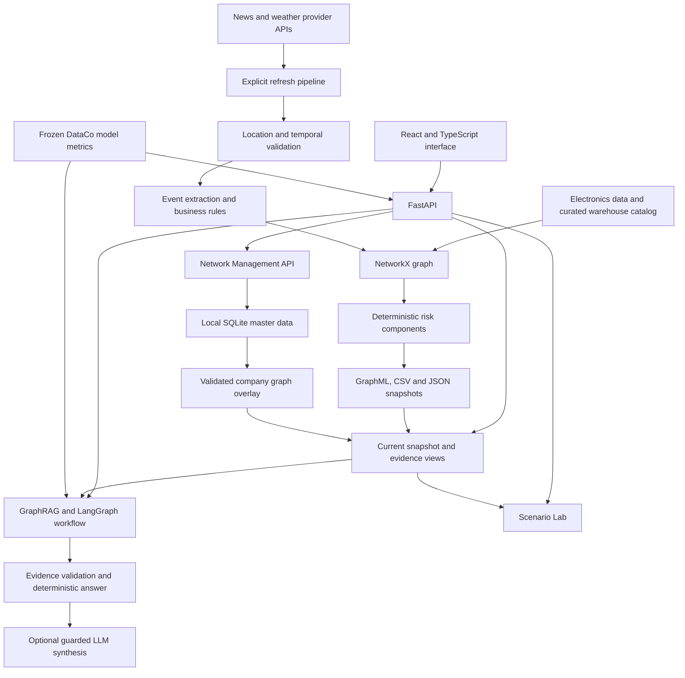

# SupplyBeacon

**Explainable supply-chain risk intelligence · MSc Data Science project**

SupplyBeacon connects an electronics supply-network graph with external weather and news evidence, transparent risk rules, grounded question answering, and warehouse disruption scenarios. A React interface brings these views together over a local FastAPI backend.

The research problem is evidence fragmentation: a warning, a warehouse location, and a product relationship rarely arrive in the same system. SupplyBeacon makes their connections inspectable, while preserving the distinction between observed external signals, modeled network relationships, catalog references, and historical machine-learning results.

> Research prototype for local exploration. Current risk scores are deterministic scenario indices, not calibrated probabilities. Historical DataCo results are separate evidence, not live shipment predictions. The interface provides demo access, not production authentication.

Documentation scope: checked against the public `main` tree at [`cda1ab8`](https://github.com/nikhilasds25-bit/SupplyBeacon/tree/cda1ab81d2ec6f401ff561c441c485ee394c0505). Local untracked artifacts are identified separately below. Implemented workflows remain subject to the known correctness defects documented in this README.

## Capabilities and workflows

| Workflow | Implemented behavior |
| --- | --- |
| Monitor disruption evidence | Dashboard, Risk Monitor, and Live Situation views show retained events, source status, temporal eligibility, and graph exposure. |
| Investigate an entity | Browse products, warehouses, and suppliers; inspect risk components, relationship paths, and evidence availability. |
| Maintain a watchlist | Save selected entities in the browser and inspect exposure from the current snapshot. |
| Ask SupplyBeacon | Retrieve graph, risk, event, weather, delivery-scenario, historical, and freshness evidence through grounded query routes. |
| Explore a warehouse disruption | Scenario Lab compares graph exposure and lists relationship-backed alternative candidates with limitations. |
| Manage a company network | Create and validate entities and relationships, preview CSV imports, inspect changes, and publish a local graph overlay when writes are enabled. |
| Review historical ML | Display frozen DataCo shipping-duration metrics when the additional local metrics artifacts are supplied; these are absent from the public tree. |
| Audit evidence | Inspect provenance, source metadata, snapshot freshness, unavailable values, and retrieval limitations. |

A typical investigation starts with an exposed warehouse, follows its approved graph paths to products and suppliers, checks the linked event and its freshness, and then uses Ask or Scenario Lab to explain the evidence. A catalog-only warehouse may have location exposure without evidence of product inventory.

## Architecture



The graph is file-backed NetworkX data, not a hosted graph database. Current state is read from retained artifacts; opening a page or asking a question does not establish that a provider was just contacted. Refresh is an explicit backend operation. Company master data is held in SQLite and published as a generated graph overlay.

## Technology stack

| Layer | Repository implementation |
| --- | --- |
| Frontend | React 18, TypeScript, Vite 6, React Router, Recharts, Lucide icons, CSS |
| API and validation | Python, FastAPI, Pydantic, Uvicorn |
| Data and graph processing | pandas, NumPy, NetworkX; CSV, JSON and GraphML artifacts |
| Grounded orchestration | LangGraph 1.2.11, LangChain Core 1.6.3, repository-defined retrieval tools |
| Historical ML | scikit-learn pipelines and joblib model artifacts |
| External data | requests; news and weather adapters |
| Local network management | SQLite, CSV import validation, generated GraphML overlay |
| Experimental dependencies | PyTorch and PyTorch Geometric are declared; their presence alone does not demonstrate a running GNN pipeline. |

`requirements.txt` also declares Streamlit, but the documented application entry points are the React frontend and FastAPI API.

## Datasets and graph model

### Electronics network

The retained electronics table is [`data/processed/electronics_supplychain_dataset.csv`](data/processed/electronics_supplychain_dataset.csv), with a separate brand/supplier mapping. Supplier and warehouse mappings and lead-time values include simulated research evidence; they must not be treated as independently verified company operations.

The saved [`graph_summary.json`](data/graph/graph_summary.json) reports **3,144 nodes and 9,350 edges**, including 2,460 Products, 18 Suppliers, 43 Brands, 3 Categories, 74 Warehouses, 60 Locations, 482 ProductModels, and 4 Events. These are counts in that saved base-graph artifact, not a guarantee about a refreshed or company-extended graph. Its event timestamps span August 2026 and do not establish current event validity.

Key relationships include:

- `Supplier → SUPPLIES → Brand → PRODUCES → Product`
- `Product → STORED_AT → Warehouse → LOCATED_IN → Location`
- `Product → BELONGS_TO → Category`
- `Brand → OFFERS → ProductModel`
- `Warehouse → CATALOG_ASSOCIATED_WITH → ProductModel`
- `Event → AFFECTS →` a graph-resolved entity

### Curated warehouse reference catalog

[`supplybeacon_full_1298.csv`](data/raw/warehouse_network/manually_curated_dataset/supplybeacon_full_1298.csv) contains 1,298 association rows. The loader validates required fields, YES/NO flags, row count, and consistent warehouse identity. The catalog carries source URLs, evidence grades, verification status, stock-verification flags, and an as-of field.

**Catalog association is not inventory.** A `ProductModel` catalog link does not prove a stocked product, quantity, capacity, or fulfillment capability. Operational exposure follows appropriate `STORED_AT` paths; even a modeled `STORED_AT` relationship must be interpreted with its provenance. Catalog-only entities can return unavailable operational risk or unavailable product impact rather than fabricated inventory.

### DataCo historical research

The DataCo loader expects raw files under `data/raw/dataco/`; that directory is ignored and the raw files are absent from this inspected checkout. Selected fitted models are published, but the evaluation metrics and run summary inspected locally are in untracked `deploy/seed/analysis/dataco/modeling/`. The historical metrics endpoint requires those additional files; the public clone does not include them. When available, these are saved historical evaluations, not live order predictions or a join into the current electronics network.

## Risk scoring, external events, and provenance

The current refresh pipeline uses eligible, graph-resolved events and an applicable structural baseline. Its score is:

```text
score = clamp(structural_baseline
              + 0.30 × strongest_weather_event_score
              + 0.20 × strongest_non_weather_event_score
              + 0.15 × strongest_business_impact_score
              + min(0.15, 0.05 × eligible_connected_event_count), 0, 1)
```

The structural terms can use normalized graph degree and connected-product counts. The current pipeline removes historical event contributions when rebuilding the structural baseline. The older baseline scorer in `src/risk_prediction/` has its own formula; it should not be confused with this current-state composition.

Risk levels use thresholds of **0.30 Medium**, **0.60 High**, and **0.85 Critical**, with Low below 0.30. These are research rules, not learned probabilities or empirical failure rates. The API exposes component values and availability, including event-only evidence and unavailable operational scores.

Implemented provider adapters include NewsAPI, NewsData.io, Currents, OpenWeather, and WeatherAPI. Collection depends on configured backend keys and provider availability. Location validation, event time validity, operational relevance rules, and approved graph paths constrain which evidence contributes to exposure. Regional warnings indicate regional scenario exposure; they do not prove an incident at a particular warehouse. A refresh with no accepted external records preserves the previous snapshot instead of presenting an empty refresh as success.

Evidence labels include `OBSERVED`, `EXTERNAL_API`, `DERIVED`, `SIMULATED`, `MODEL_OUTPUT`, and `USER_ENTERED`. A legacy `MODEL_OUTPUT` label on risk evidence does not make a deterministic score a learned prediction. Source records, timestamps, graph paths, field provenance, and freshness metadata supply the context needed to interpret each answer. The published graph and event files are historical snapshots. Local `data/current/` files are retained snapshots too: the directory name, a LIVE interface badge, or an `EXTERNAL_API` label does not establish a fresh provider call. Genuine live external intelligence requires a successful configured collection with recent source/fetch timestamps and valid location and temporal evidence. Simulated network mappings and derived risk remain simulated/derived after refresh. Check System & Provenance before interpreting any retained record as current.

## GraphRAG and LangGraph grounded answers

[`src/graphrag/`](src/graphrag/) retrieves existing entity relationships and evidence. [`src/agentic/service.py`](src/agentic/service.py) implements a LangGraph workflow that analyzes a query, resolves entities, builds a retrieval plan, conditionally retrieves relevant domains, merges and validates evidence, and produces a deterministic answer or safe fallback.

The `/query` and `/query/agentic` routes support grounded questions such as:

- “Which warehouses are affected by external events?”
- “What evidence supports this product's risk assessment?”
- “What are the historical DataCo shipping model metrics?”
- “What if this warehouse is unavailable?” using a warehouse present in the graph.

The workflow is designed to bound answers by available evidence and leave missing relationships unresolved. Entity-scoping, delivery mapping, ranking, and network-summary defects remain; the existence of evidence validation does not guarantee correctness for every query. Optional OpenAI-compatible LLM synthesis is disabled by default and guarded by evidence validation. It does not replace authoritative risk, inventory, scenario, or historical facts. This is graph-based retrieval, not an implemented embedding similarity search.

Delivery estimates are a separate **rule-based scenario**: a retained baseline lead time plus a risk-level/event-dependent delay range. They are not DataCo model inference, causal predictions, or delivery guarantees. The agentic delivery tool/response contract currently has a mapping defect, so a computed estimate may not reach the returned `delivery_risk` field or the frontend.

## Scenario Lab and Network Management

**Scenario Lab** uses the current graph to inspect warehouse unavailability, compare affected product sets with current exposure, and list alternative warehouse or supplier candidates supported by existing relationships. Simulation is read-only and does not refresh external sources. Duration and severity are descriptive assumptions; they do not change exposure counts or inventory. Candidate capacity, stock, transport feasibility, and commercial eligibility are not verified. Catalog-only targets explicitly lack inventory-backed product impact.

**Network Management** supports local product, supplier, warehouse, location, and relationship records, validation, duplicate checks, deactivation, a change log, import preview/confirmation, and graph preview/publish. Published company data forms an overlay rather than editing the retained base datasets. Writes are disabled by default and require `SUPPLYBEACON_MASTER_WRITE_ENABLED=true` for local development. This flag is not user authentication or role-based authorization.

## GraphSAGE: published embeddings and reproducibility limits

The public repository publishes [`node_embeddings.csv`](data/gnn_prediction/node_embeddings.csv). The retriever reports embedding availability only and explicitly performs **no vector similarity retrieval**. Neither current deterministic scoring nor the saved DataCo regressor is a GraphSAGE risk predictor.

The public tree does not include a GraphSAGE encoder/decoder, autoencoder reconstruction objective, training entry point, or evaluation record. The published embeddings do not establish their training method, quality, or publicly reproducible autoencoder training. Any historical GraphSAGE autoencoder experiment requires the original code and experiment records before those claims can be verified; no supervised disruption-prediction performance is claimed for these embeddings.

## Historical DataCo model and saved results

The supervised target is **`Days for shipping (real)`**, an observed historical duration in days, not the simulated electronics `Lead_Time_Days` field. The implementation uses preprocessing pipelines, order-time features and calendar features, and a chronological split by unique order date: 70% / 15% / 15% of dates, not necessarily of rows.

The locally retained, untracked run summary records **134,974 training**, **28,876 validation**, and **16,669 test** rows. Frozen historical test results from local `deploy/seed/analysis/dataco/modeling/baseline_metrics.csv` are rounded below. That CSV is absent from the public repository; these numbers are not independently reproducible from a fresh clone alone:

| Model | MAE (days) ↓ | RMSE (days) ↓ | R² ↑ |
| --- | ---: | ---: | ---: |
| Dummy mean | 1.4213 | 1.6164 | -0.0000004 |
| Ridge | 1.0163 | 1.2661 | 0.3865 |
| Random forest | 0.9939 | 1.2756 | 0.3772 |
| Histogram gradient boosting | 0.9881 | 1.2640 | 0.3885 |

These values were read from local saved artifacts, not reproduced in this documentation pass or verified by retraining from public inputs. The API's historical metrics endpoint selects the histogram gradient boosting test row. Fitted dummy, ridge, and histogram gradient boosting artifacts exist; the large random forest artifact is ignored and absent.

The local, untracked `deploy/seed/analysis/dataco/modeling/feature_audit.json` and published training code describe exclusion of outcome-related fields such as delivery status, late-delivery labels, realized shipping dates, and delay-derived values, as well as customer PII and identifiers. Availability of scheduled duration and some monetary fields at order creation remains an assumption requiring operational validation.

The training code selects its reported “best” model using **test MAE**, which limits the test set's independence as a final evaluation. Future work should select models using validation data and reserve an untouched test set. No transfer accuracy, current-weather forecasting performance, causal effect, or live shipment prediction is established by these results.

## Local setup

Commands below are derived from the existing entry points, Vite proxy, package scripts, and Dockerfile. A clean backend installation and full application startup were **not executed** during this README update.

**Fresh-clone preparation is incomplete.** The runtime and evaluation directories below are absent from the checked public tree. They are present but untracked locally, except for the raw DataCo directory, which is also absent locally:

| Required or supporting local artifact | Consequence for a public clone |
| --- | --- |
| `deploy/seed/current/` | The startup bootstrap cannot seed current data from files that are not published. |
| `data/current/` | Retained current-state graph, risk, weather, events, impacts, and metadata are not supplied. |
| `data/risk_prediction/` | Saved baseline risk scores/summary are not supplied; refresh and baseline-dependent workflows need preparation. |
| `deploy/seed/analysis/dataco/modeling/` | `baseline_metrics.csv`, `run_summary.json`, and `feature_audit.json` are unavailable; the historical metrics API can return 404. |
| `data/raw/dataco/` (ignored and absent locally) | Raw historical inputs needed for retraining are not supplied. |

The published base graph, processed electronics data, warehouse catalog, embeddings, and three fitted DataCo models do not replace these missing runtime/evaluation inputs. Obtain the appropriate artifacts or prepare compatible data before expecting the complete application or backend suite to work. No complete fresh-clone preparation procedure has been verified. The commands below assume that preparation has already occurred; this README-only change does not publish additional files.

Use a modern Python 3 environment (the Dockerfile specifies Python 3.13; Python 2 is unsupported) and Node.js with npm. From the repository root, in PowerShell:

```powershell
py -3 -m venv .venv
.\.venv\Scripts\Activate.ps1
python -m pip install --upgrade pip
python -m pip install -r requirements.txt
python -m pip install python-multipart
Copy-Item .env.example .env
python -m uvicorn src.api.app:app --host 127.0.0.1 --port 8780
```

`python-multipart` is required by the implemented file-upload routes but is currently missing from `requirements.txt`. Most Python dependencies are unpinned, so clean-install compatibility remains to be verified. The repository Dockerfile also installs that requirements file without this additional dependency; its build/runtime was not verified here.

In a second terminal:

```powershell
cd frontend
npm ci
npm run dev
```

Open the Vite URL (normally `http://localhost:5173`) and use the demo form's prefilled access. API health is at `http://127.0.0.1:8780/health`; FastAPI's schema UI is at `http://127.0.0.1:8780/docs`. Vite forwards `/api` to port 8780 and removes the prefix. The Dockerfile instead defaults to port 8000; adjust the frontend target when using that configuration.

### Optional configuration

- Keep provider keys and optional `ELECTROGRAPH_LLM_*` settings in the root `.env`, which the backend loads. Leave `SUPPLYBEACON_LLM_ENABLED=false` for deterministic operation.
- `SUPPLYBEACON_ADMIN_API_KEY` gates the refresh endpoint through its `X-SupplyBeacon-Admin-Key` header. Configure it privately before using refresh; it is not a general authentication system.
- For local company-data editing, add `SUPPLYBEACON_MASTER_WRITE_ENABLED=true` to the backend environment. Restart the backend after changing startup configuration.
- `SUPPLYBEACON_CURRENT_DATA_DIR`, `SUPPLYBEACON_MASTER_DB_PATH`, and `SUPPLYBEACON_MASTER_GENERATED_DIR` override local storage paths when needed.
- Vite reads its environment from `frontend/`. For a nondefault backend, put `VITE_DEV_API_TARGET` in `frontend/.env.local`; `VITE_API_BASE_URL` configures a separate API origin. Keep frontend origins consistent with `SUPPLYBEACON_ALLOWED_ORIGINS`.

Never put secrets in `VITE_*` variables, browser code, screenshots, or committed files. No populated environment file is needed to inspect retained snapshots. On startup, an empty current-data directory can be bootstrapped only if a complete deployment seed has been supplied separately. Without the unpublished seed, bootstrap leaves current data empty; some routes may return unavailable data or fail. Seeded content is retained historical evidence, not a fresh provider fetch.

## Automated checks and verification

From the activated backend environment, install the test tools separately because they are not declared in `requirements.txt`:

```powershell
python -m pip install pytest httpx
python -m pytest tests -q
```

The suite covers risk components and watchlists, temporal eligibility, source failures, location safety, weather resolution, grounded query domains, LangGraph routing, scenario semantics, catalog/inventory separation, master-data imports and overlays, current-state storage, and API security boundaries. Its startup hook can seed a missing current snapshot; use a disposable checkout or an isolated current-data directory when testing.

Frontend checks:

```powershell
cd frontend
node --test tests/currentSnapshot.test.cjs
npx tsc -p tsconfig.app.json --noEmit
npm run build
```

### Previously executed local validation

The project owner reports the following prior results from a prepared local environment:

| Check | Recorded local result |
| --- | --- |
| Backend regression/acceptance suite | **306 tests passed**. |
| Frontend snapshot-hook tests | **3 tests passed**. |
| Vite production build | **Successful local build**. |

These results describe the prepared local workspace, including its additional artifacts and installed dependencies. They are **not fresh-clone verification**, proof of complete workflow correctness, or a claim that the known defects below are repaired. No execution logs for the reported backend run or successful build are published in the inspected tree; those results are recorded here as owner-reported prior local validation.

During this README review, `node --test frontend/tests/currentSnapshot.test.cjs` was rerun against existing dependencies: **3 passed, 0 failed**. The earlier documentation pass also passed `tsc -p frontend/tsconfig.app.json --noEmit`. Backend tests were not rerun in these documentation passes because the available Python 3 runtime lacks the required backend/test packages. An earlier Vite attempt in the restricted documentation environment hit a temporary-config write permission error; this does not invalidate the reported prior successful local build.

Clean dependency installation, complete startup from only public files, browser workflows, current provider access, LLM service operation, and historical retraining were not verified in this review. The frontend tests exercise snapshot polling behavior, not all frontend pages or end-to-end delivery/ranking correctness.

## Visual assets

The repository contains brand/login artwork in `frontend/public/assets/`, including `supplybeacon-login-v3.png`, `supplybeacon-brandd-reference.png`, and `logistics-transport-bg.png`. These are design assets, not verified screenshots of working application pages. No application screenshots are presented as execution evidence.

## Known correctness defects

The following issues remain open in the inspected implementation. They are disclosed here without changing source code. Prior passing tests do not establish coverage of these cases.

| Area | Current defect and interpretation limit |
| --- | --- |
| Entity-scoped risk retrieval | `current_risk_tool` filters node facts to `MODEL_OUTPUT`, omitting `DERIVED` current risk components while admitting embedding-availability metadata. Generic graph retrieval also uses token-based entity matching. Entity-specific answers can therefore have incomplete or incorrectly scoped supporting evidence; verify entity IDs, risk rows, and paths rather than assuming every returned fact belongs to the intended entity and domain. |
| Delivery-response mapping | `delivery_scenario_tool` returns the estimate directly, but the agentic answer builder reads a nested `delivery_result["delivery_risk"]`. A computed delivery scenario can therefore be omitted from the returned response and UI. Availability of the underlying estimator does not establish a working end-to-end delivery workflow. |
| Warehouse ranking | API query routing recognizes “highest-risk” and “most at risk” variants, while agentic ranking selection only recognizes particular “which/what warehouses” forms and lowers the threshold only for literal “highest risk”. Other ranking paths use different affected-event/level filters. Equivalent warehouse questions can therefore produce different candidate sets or bypass the intended ranking. Results are not guaranteed to be a consistent complete network ranking. |
| Network summary | The LangGraph network-answer branch treats the absence of Medium/High/Critical rows as proof that all scored nodes are Low and that no operational disruptions affect the network. It counts the entire risk frame and treats all active event records as weather context. Missing/unavailable risk or active event-only exposure can therefore yield a misleading all-clear, and chat summaries can disagree with the separate API summary. |

These areas need source fixes and targeted regression tests before their outputs can be relied on. Where possible, inspect the underlying current-state records, explicit entity IDs, eligibility, and typed graph paths; a Low or unavailable summary is not proof of no disruption.

## Research scope, limitations, and future work

SupplyBeacon demonstrates how graph evidence, transparent business rules, and bounded agent orchestration can support explainable supply-chain investigations. Its evidence boundaries are part of the research design:

- Simulated mappings and catalog references do not establish real stock, company operations, fulfillment capacity, or recovery feasibility.
- Rule scores and delivery scenarios need calibration and external validation before operational decision use.
- Provider coverage, timestamps, location resolution, and source availability constrain current-event interpretation; stale snapshots require explicit refresh and review.
- Graph retrieval cannot discover missing relationships or prove causality. Embedding training and its value are not reproducible from the retained artifacts alone.
- Historical ML results describe a different dataset. Raw DataCo inputs, feature timing, test-based model selection, and independent evaluation require further verification.
- Browser demo access, a refresh key, CORS settings, and local write flags do not provide production identity, authorization, or multi-tenant isolation. No public deployment or production readiness is claimed.
- Python dependency locking, the missing multipart requirement, publication/preparation of runtime artifacts, fresh-clone test execution, correction of the known defects above, and end-to-end runtime verification remain engineering follow-up work.

Future improvements include verified company inventory feeds, richer evidence coverage, reproducible graph representation experiments, independently evaluated historical models, calibrated uncertainty, operational validation of alternative candidates, and production security controls. These are proposed improvements, not implemented capabilities.
